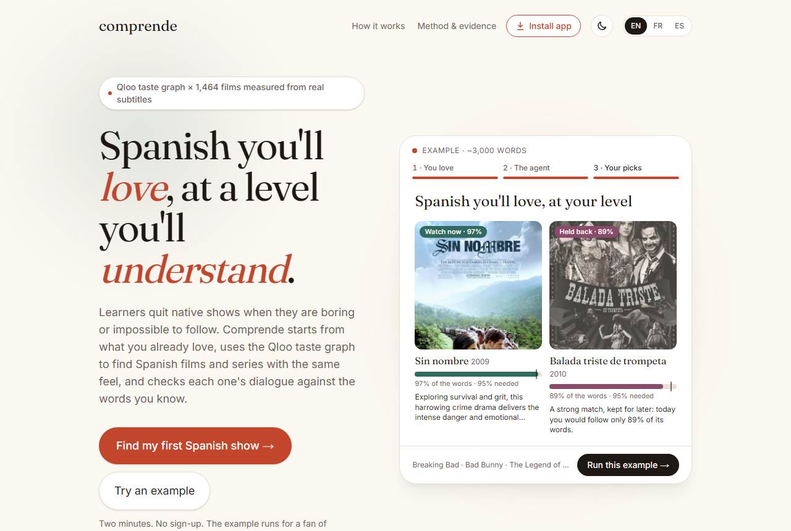
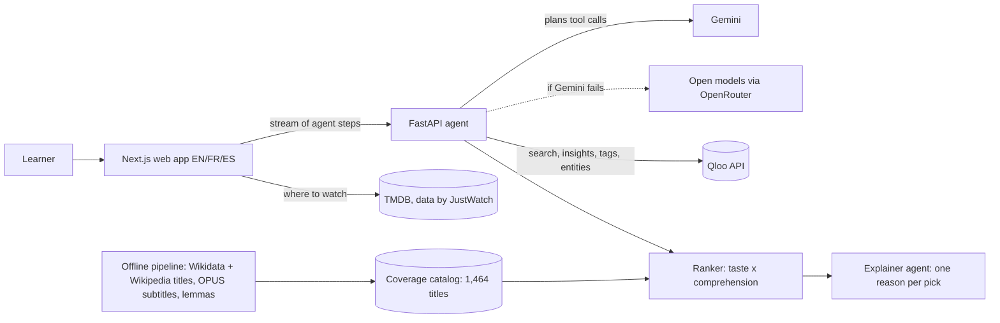

# Comprende

**Spanish films and series you'll love, at a level you'll understand.**

**Try it:** https://comprende.vercel.app · **Method and evidence:** https://comprende.vercel.app/method



You watched *Money Heist* with subtitles. How far are you from watching it without them? At ~3,000 words you'd know 93% of its dialogue; about 1,000 more words and you can drop them. Comprende answers that for any of 1,464 Spanish titles, and finds the ones you'll love next.

Learners are told to watch shows in Spanish. They pick something famous, get lost in the dialogue, and quit. Comprende starts from three things you love, in any domain (a show, an artist, a game):
- it uses the **Qloo** taste graph to find Spanish-language films and series with the same feel;
- it measures how much of each title's dialogue you would understand, from real subtitles;
- it ranks them so you start with what you'll enjoy **and** follow, and holds back the title you'd love most until you're ready.

## Try it in 60 seconds

1. Open https://comprende.vercel.app. **Try an example** replays a recorded real run in a few seconds. Or type a title you know in **Can you watch it without subtitles?** ("Money Heist", "Roma", "The Platform").
2. For your own picks, give three favourites, choose which Spanish you want to hear (Spain, Latin America or both), and take the 64-word check or choose a level.
3. Watch the agent's steps live, then read your picks:
   - **Watch now:** at least 95% of the words known.
   - **A good stretch:** 90–95%.
   - One title **held back on purpose**.

   Each pick comes with a one-line reason, how much dialogue it has, and where to watch it in your country.
4. Drag the **vocabulary slider** on the map to see titles move from "later" to "watch now".
5. Save titles to **My list**. After a film, answer "Watched it?" and your level moves. The next visit tells you what came within reach. Add a **weekly film night** to Google Calendar with your next film and a link back.
6. Switch **EN / FR / ES** and light / dark in the header.

## How Qloo powers it

| Step | Qloo API | Why |
|---|---|---|
| Resolve favourites from any domain | `GET /search` (films, series, artists, games, books, podcasts) | "Breaking Bad", "Rosalía", "Zelda" become Qloo entities |
| Spanish-language films and series for your taste | `GET /v2/insights` with `filter.type`, `signal.interests.entities`, `filter.release_country` (Spanish-speaking countries) | Cross-domain taste becomes Spanish titles |
| The Spanish you want to hear | `filter.release_country` narrowed to Spain or to Latin America, at the learner's choice | Accents and words differ; a learner of Mexican Spanish gets Mexican and Argentine titles |
| Score the titles we measured | `GET /v2/insights` with `filter.results.entities` (parallel batches of 50) | A taste score for every title whose difficulty we know |
| Explain each pick | `feature.explainability`, plus Qloo's genre, themes and tone descriptions | "Because you like…" and the explainer's reason come from Qloo's data, not the model's memory |
| Map our catalog to Qloo | `GET /entities` with `external.imdb.ids`, `external.wikidata.ids` | Exact ids (1,438 of 1,464 titles), no fuzzy matching |
| Spanish-language music | `GET /v2/tags` and `GET /v2/insights` with `filter.tags`, kept to genres sung in Spanish | Listening practice from the same taste |
| Personal, not just popular | Mean affinity of each title over 10 reference tastes (`backend/scripts/build_taste_baseline.py`) | Ranking by lift (your affinity minus the typical one), with a small nudge toward well-known (Qloo `popularity`) and recent titles between close matches |

**Two agents, and every number comes from Qloo or the subtitles, never from a language model.**
- **Planner** (Gemini with tool calling): decides the Qloo calls and runs them in parallel. A deterministic ranker orders the results.
- **Explainer:** writes one reason per pick in English, French and Spanish, only from Qloo's description of the title. Its output is checked before it is shown.
- **When the models fail:** if Gemini is down or out of quota, open models through OpenRouter take over (`OPENROUTER_API_KEY`). If no model answers, the same tools run as a fixed plan.

## Evidence

| Claim | Result | Where |
|---|---|---|
| Titles measured from real subtitles | 1,464 Spanish-original films and series, language checked against Wikidata and Wikipedia | `data/catalog_es.json` |
| The difficulty measure behaves as published research predicts | Median title needs 3,000 lemmas for 95% coverage (Webb & Rodgers 2009: about 3,000 word families plus proper nouns for English film) | `data/validation_es.md` |
| A hypothesis that did not hold | Animation and family titles are **not** easier than dramas (94.0% vs 95.4% coverage at 3,000 lemmas) | `data/validation_es.md` |
| A language model alone ignores level | Gemini with no Qloo and no subtitles, on 20 profiles: of its 85 measured picks, 58.8% followable at the learner's level, 14.1% below 90% coverage | `eval/results/report.md` |
| Qloo is what makes it personal | Same subtitle data without Qloo (popularity instead of taste): 8.0% distinct titles across 20 learners, list overlap 0.66. With Qloo: 61.0% distinct, overlap 0.04 | `eval/results/report.md` |
| Comprende vs. a language model, first five picks | 70.0% followable at the learner's level vs 63.8%; 0.0% far too hard (< 90%) vs 10.6%; 99.0% verified Spanish-original vs 90.0% | `eval/results/report.md` |
| Real people can use it | 9 testers (6 learning Spanish): none needed help, median 14 s to results, 4.0 of the first 5 picks they would watch, 9 of 9 explained "held back" correctly | user test sheet (not in the repo: testers' answers) |

**Reproduce:** `python pipeline/scripts/validate_catalog.py`, `python eval/run_llm_baseline.py`, `python eval/run_comprende.py`, `python eval/metrics.py`.

## Architecture



| Folder | What |
|---|---|
| `pipeline/` | Offline: Spanish-original titles (Wikidata, language checked on Wikipedia), subtitles (OPUS OpenSubtitles, fetched by byte range), lemmatisation with clitic repair, frequency list, coverage curves, dialogue density, vocabulary-check items |
| `backend/` | Qloo client (server-side key, cached), planner and explainer agents, model backups, ranker, API with server-sent events, recorded example |
| `web/` | Next.js app: "can you watch it without subtitles?" lookup, favourites, word check, live agent steps, results, map, My list, welcome back, weekly calendar reminder, methods page, EN/FR/ES, installable |
| `eval/` | Fixed taste profiles, language-model baseline, Comprende runner, title verification, report |

## Run locally

```bash
cp .env.example .env            # QLOO_API_KEY and GEMINI_API_KEY; OPENROUTER_API_KEY and TMDB_API_KEY are optional
pip install -r backend/requirements.txt
cd backend && uvicorn app.main:app --port 8000
# in a second terminal, from the repo root:
cd web && npm install && npm run dev   # http://localhost:3000
```

**Tests** (CI runs them all):
- `python -m pytest -q pipeline/tests`
- `cd backend && python -m pytest -q tests`
- `node --experimental-strip-types web/lib/comprehension.parity.test.ts`: the web app's maths checked against the Python pipeline.
- `node --experimental-strip-types web/lib/profile.test.ts`
- `node --experimental-strip-types web/lib/reminder.test.ts`

To refresh the home-page example before a demo: `python backend/scripts/record_example.py`.

Deploying to Vercel (two projects, environment variables, checks): [docs/DEPLOY.md](docs/DEPLOY.md).

## Data and credits

- **Taste:** Qloo Insights API.
- **Titles:** Wikidata (CC0); original language and title casing checked on Wikipedia.
- **Subtitles:** OPUS OpenSubtitles v2024 (Lison & Tiedemann 2016), from [opensubtitles.org](https://www.opensubtitles.org/). Only word counts derived from subtitles are stored.
- **Lemmas:** spaCy, simplemma. Full references in [pipeline/README.md](pipeline/README.md).
- **Where to watch:** streaming data by JustWatch via TMDB. This product uses the TMDB API but is not endorsed or certified by TMDB.

## Author

Wendemi Brice Romeo ZEMBA

## License

MIT, see [LICENSE](LICENSE).
