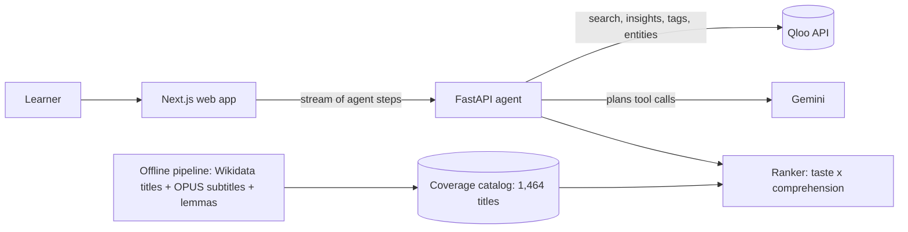

# Comprende

**Spanish films and series you'll love, at a level you'll understand.**

**Try it:** https://comprende.vercel.app · **Method and evidence:** https://comprende.vercel.app/method

Comprende is an agent for people learning Spanish by watching native content. Tell it three things you love, in any domain (a show, an artist, a book, a game). It uses the **Qloo** taste graph to find Spanish-language films and series with the same feel, measures how much of each title's dialogue you would understand from real subtitle text, and ranks them so you start with what you'll enjoy **and** follow. It deliberately holds back the title you'd love most but can't follow yet.

Built for the Qloo Agentic Hackathon (2026).

## Try it in 60 seconds

1. Open https://comprende.vercel.app and pick three favourites (or tap the suggestions).
2. Take the 64-word check, or choose a level ("Just starting", "Getting by", "Comfortable").
3. Watch the agent's steps live, then read your picks: **Watch now** (≥ 95% of words known), **A good stretch** (90–95%), and one title **held back on purpose**.
4. Drag the **vocabulary slider** on the taste × comprehension map to see titles move from "later" to "watch now".
5. React to a pick (Loved it / Too hard / Not for me) and press **Update my picks**: the agent re-plans.

## How Qloo powers it

| Step | Qloo API | Why |
|---|---|---|
| Resolve favourites from any domain | `GET /search` | "Breaking Bad", "Rosalía", "Zelda" become Qloo entities |
| Spanish-language films and series for your taste | `GET /v2/insights` with `filter.type` (movie / tv_show), `signal.interests.entities`, `filter.release_country` (Spanish-speaking countries) | Cross-domain taste → Spanish titles |
| Score the titles we measured | `GET /v2/insights` with `filter.results.entities` | Taste affinity for every title whose difficulty we know |
| Explain each pick | `feature.explainability` | "Because you like Breaking Bad" comes from Qloo, not from the model |
| Map our catalog to Qloo | `GET /entities` with `external.imdb.ids`, `external.wikidata.ids` | Exact ids, no fuzzy matching |
| Spanish-language music | `GET /v2/tags` (genre tag discovery: Latin, Reggaeton, Rock En Español, Flamenco…) + `GET /v2/insights` with `filter.tags` | Listening practice from the same taste |
| Personal, not just popular | Mean affinity of each title over 10 reference tastes (`backend/scripts/build_taste_baseline.py`) | Ranking by lift (your affinity minus the typical one) stops generally liked titles topping every list |

The agent (Google Gemini with tool calling) plans these calls; a deterministic ranker orders the results. **Every number a learner sees comes from Qloo (affinity) or from subtitle data (coverage), never from the language model.** If Gemini is unavailable, an open model through OpenRouter (Gemma, Nemotron) can plan instead when `OPENROUTER_API_KEY` is set; if no model answers, the same tools run as a fixed plan. A second agent, the explainer, then writes one reason per pick from Qloo's own description of the title.

## Evidence

| Claim | Result | Where |
|---|---|---|
| Titles measured from real subtitles | 1,464 Spanish-original films and series | `data/catalog_es.json` |
| The difficulty measure behaves as published research predicts | Median title needs 3,000 lemmas for 95% coverage (Webb & Rodgers 2009: ~3,000 word families + proper nouns for English film) | `data/validation_es.md` |
| A hypothesis that did not hold | Animation/family titles are **not** easier than dramas (94.1% vs 95.4% coverage at 3,000 lemmas) | `data/validation_es.md` |
| A language model alone ignores level | Gemini, no Qloo, no subtitles, 20 profiles: of its 88 measured picks, 61.4% followable at the learner's level, 14.8% below 90% coverage | `eval/results/report.md` |
| Qloo is what makes it personal | Same subtitle data without Qloo (popularity instead of taste): 8.0% distinct titles across 20 learners, list overlap 0.66. With Qloo: 68.5% distinct, overlap 0.03 | `eval/results/report.md` |
| Comprende vs. a language model, first five picks | 69.7% followable at the learner's level vs 60.0%; 0.0% far too hard (< 90%) vs 14.0%; 93.5% verified Spanish-original vs 86.5% | `eval/results/report.md` |

Reproduce: `python pipeline/scripts/validate_catalog.py`, `python eval/run_llm_baseline.py`, `python eval/run_comprende.py`, `python eval/metrics.py`.

## Architecture



| Folder | What |
|---|---|
| `pipeline/` | Offline: Spanish-original titles (Wikidata), subtitles (OPUS OpenSubtitles, fetched by byte range), lemmatisation with clitic repair, frequency list, coverage curves, vocabulary-check items |
| `backend/` | Qloo client (cached, server-side key), agent, ranker, API with server-sent events |
| `web/` | Next.js app: favourites, word check, live agent steps, results, map, feedback, methods page |
| `eval/` | Fixed taste profiles, LLM-only baseline, Comprende runner, title verification, report |

## Run locally

```bash
cp .env.example .env            # add QLOO_API_KEY and GEMINI_API_KEY
pip install -r backend/requirements.txt
cd backend && uvicorn app.main:app --port 8000
cd web && npm install && npm run dev   # http://localhost:3000
```

Tests: `python -m pytest -q pipeline/tests`, `cd backend && python -m pytest -q tests`, `node --experimental-strip-types web/lib/comprehension.parity.test.ts` (the web app's maths checked against the Python pipeline). CI runs all three.

## Limits

- Coverage counts words, not speech rate, accents or slang. As a rough guide to pace, films whose running time is known (from the subtitle metadata or from Qloo) also show their dialogue density: subtitle words per minute of running time, in thirds (under 60, 60-80, over 80). It is not speech rate: silent scenes count in the minutes and subtitles condense speech. Accents and slang are not measured; a learner can follow 95% of the words of a fast Andalusian thriller and still struggle.
- Only titles in the open subtitle corpus are measured; others are labelled "difficulty not measured", never guessed. Series coverage is thin (the corpus files episodes separately, so only 40 of the 1,464 measured titles are series).
- The word check is short (64 items) and approximate. Spanish words that look like English or French ones (cognates, false friends) were left out of it because they can be recognised without knowing Spanish, so the estimate may be a little low for those learners.
- The music lane depends on Qloo genre tags: an artist must carry a genre sung in Spanish (reggaeton, cumbia, flamenco, Latin pop, Spanish rap...) and none sung in another language. Lyrics are not measured. Podcasts are left out: Qloo's "Spanish" podcast tags describe topics (Spanish history), not the language of the show.
- Qloo's language filter is by release country, which also returns co-productions in English. Titles are kept only if Wikidata lists them as Spanish-original or every production country is Spanish-speaking, and dropped when their English Wikipedia infobox leaves Spanish out or lists English first (52 titles). Titles without an English Wikipedia article are not checked this way, so a rare Catalan- or English-language title can still get through.
- Qloo returned taste scores for 657 of our 1,438 Qloo-matched titles; the others cannot be ranked by taste.
- Two language-model agents plan the calls and write each pick's reason. The reasons are written only from Qloo's description of the title and checked before they are shown, but they are still generated text. Every number shown (affinity, coverage, vocabulary) comes from Qloo or the subtitles, never from a model.
- The hosted demo runs on free model quotas (Gemini, with open models through OpenRouter as backup). When all of them are used up for the day, the same tools run as a fixed plan and the cards keep their standard text.
- Subtitle data comes from the OPUS OpenSubtitles corpus, distributed for research; only word counts derived from it are stored. A commercial version would need licensed subtitle text (from OpenSubtitles or from streaming partners).
- Qloo describes what groups of people tend to like; it does not predict what one person will do. No personal data is sent to Qloo or to the language models: only the names and ids of things the learner says they like.

## Data and credits

Taste data: Qloo Insights API. Titles: Wikidata (CC0). Subtitles: OPUS OpenSubtitles v2024 (Lison & Tiedemann 2016), from [opensubtitles.org](https://www.opensubtitles.org/); only word counts derived from subtitles are stored. Lemmas: spaCy, simplemma. Full references in [pipeline/README.md](pipeline/README.md).

## License

MIT, see [LICENSE](LICENSE).
